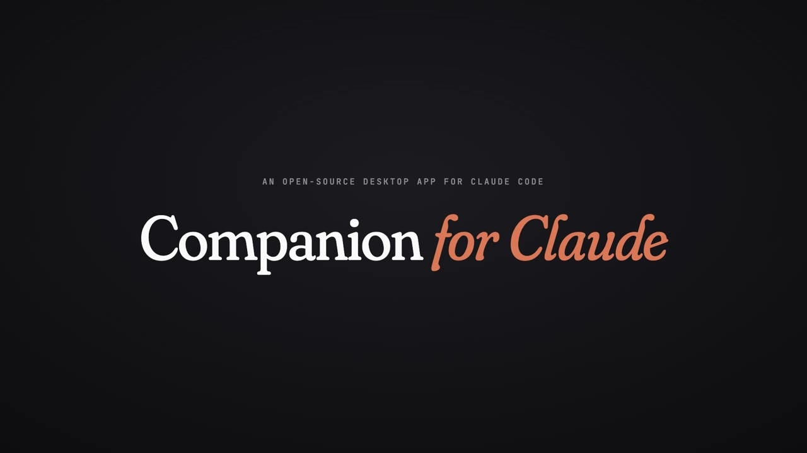
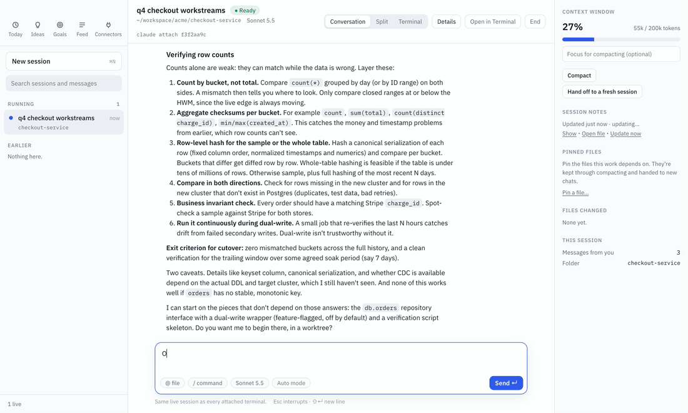
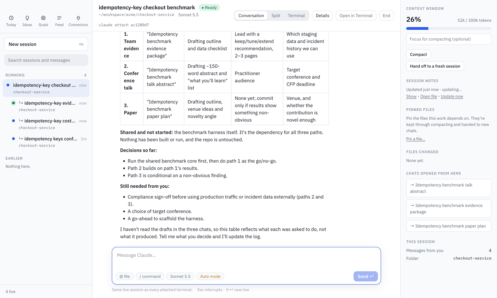

# Companion for Claude

**Context and session management for Claude Code, to improve developer productivity and engineering workflows.**

Companion for Claude is an open-source desktop app around Claude Code. It keeps every Claude Code session in one window, shows what each session is carrying in its context, and gives you the tools to keep that context focused: notes, hand-offs, linked sub-sessions and side threads. Around that core it adds what a developer needs day to day (sessions grouped by what they need from you, a morning recap) and the building blocks for engineering workflows (reviewing a session's changes like a pull request, approvals, connectors).

[](docs/media/demo.mp4)

<sub>▶ [Watch the demo (4:40)](docs/media/demo.mp4). Real recordings of Companion running real Claude Code sessions: sessions grouped by what they need, the context breakdown, an audit, branching, side chats, notes and hand-off, and reviewing a session's changes.</sub>



<sub>Real recording, sped up. "Open a separate chat for the caching workstream" opens a new linked session that already knows the plan. [MP4 version](docs/media/branching.mp4).</sub>

## Why

Long Claude Code sessions get slower, more expensive and less accurate as their context fills up. One chat rarely stays one topic: forty messages later the plan you made is buried under detours, every later turn pays for all of it again, and when the session ends, its decisions sit in a transcript nobody reads. Opening a new chat by hand loses everything you already worked out, and nothing connects the chats afterwards.

Companion treats context as something you manage: you can see it, keep it focused, split it when the work splits, and carry what matters into the next session.

## Context and session management

**See what fills the context.** A context-window meter, sized to the model's real limit (200k or 1M tokens), warns when it's getting full and breaks down what is in it, from Claude Code's own `/context`: system prompt, tools, MCP tools, skills, messages and the autocompact buffer. **Compact** runs `/compact` with an optional focus, and **Pinned files** are kept through compacting and handed to new chats.

**Session notes.** After each turn, once the session goes quiet, Companion updates a Markdown notes file for the session: the goal, decisions with their reasons, specifics (paths, commands, values, errors and fixes), constraints and open questions. Anyone can read them, and new sessions start from them.

**Hand off to a fresh session.** When a session runs long, **Hand off** opens a new one that picks up from the notes and pinned files, without the old context.

**Sub-sessions (branching).** Say *"open a separate chat for the caching workstream"*, in Companion or in any attached terminal, and Companion branches it:

- **A new linked session opens and starts working right away**, on an opening message Claude writes for that topic.
- **It knows the earlier conversation as hidden background**: the parent's notes plus its most recent exchanges. Its own thread stays clean.
- **It can look up the rest.** When it needs a detail the notes left out (an exact error, the command that worked, a number), it searches the earlier conversation word for word, including full tool output. It can only read the chats it came from.
- **It stays linked.** Child sessions nest under their parent in the sidebar, and **the parent becomes a decision log**: every chat opened from it, and where each one stands.



**Side chats (threads).** Hover any message and click its reply arrow (**Ask on the side**) to ask about it in a thread beside the chat. Claude answers with the whole conversation in mind, but nothing you ask there is added to the chat, so it doesn't grow the chat's context or its cost on later turns. Answers come from a fork of the chat (`claude -p --resume <id> --fork-session`) on the same model, so the history is read from the prompt cache, and each answer shows its tokens and cost. Follow-ups continue the thread; deleting a thread deletes its fork.

**Audit.** Run an audit on a session to find where its tokens went: files read again and again, facts rediscovered, approaches retried after they failed, full test suites run when one test would do, output nobody filtered, plan churn. Detectors run over a per-call token timeline, a second model confirms or rejects each finding, and every finding comes with its cost, its likely cause in your setup (CLAUDE.md, skills, settings) and a fix. Each finding links to the step it refers to, and the share of the cost that was wasted shows in the sidebar.

## Developer productivity

**Every session in one window, grouped by what it needs.** Live and recent Claude Code sessions from all your projects are in the sidebar: *Needs you* (waiting for an approval or an answer), *Running* and *Earlier*. A session that gets stuck on a question moves to the top. Full-text search covers everything you and Claude wrote, and the folder menu narrows the list to one project, its worktrees included.

**Every step, not just the answer.** Opening a session shows the whole conversation, with each tool call as a step you can expand to see the exact diff or command output. Permission prompts appear as cards in the conversation; answer them there or in any attached terminal.

**Today.** A morning recap of yesterday's work by project, with blockers and action items. "Continue where I left off" resumes the session an item came from; "Start session" opens a new one on it.

**Drive a session from anywhere.** Sessions run as Claude Code background sessions (`claude --bg`), which any number of terminals can attach to. Type in Companion's composer, its terminal pane, or a terminal where you ran `claude attach <id>`: it is one live session, and every place shows the same thing. **Open in Terminal** opens it in iTerm or Terminal, **End** stops it (`claude stop`), and sending a message later continues it. Quitting Companion only detaches.

**New sessions with guardrails.** Pick the model, whether Claude plans first, asks before every edit or accepts edits, and whether it works in the current checkout or its own git worktree.

Coming next: **Ideas** (follow-ups from your conversations, ready to run) and **Goals** (long-running checks that report back when something changes).

## Engineering workflows

**Review a session like a pull request.** **Review** shows everything a session changed: one net diff per file, a short explanation of why each file changed, and Claude's own words beside each edit with a link to that moment in the chat. It's built from the session's own record, not from git, so it shows exactly what the AI changed and nothing else.

**Connectors.** Browse and manage Claude Code's plugins, marketplaces and MCP servers in one place. GitHub activity (reviews waiting on you, failing CI, assigned issues) feeds into the morning recap.

**Planned: always-on agentic workflows.** Agents that keep running in the background on a team's engineering work, such as watching CI, triaging new issues or keeping a branch up to date, and that report back and ask for approval through the same sessions, notes and review flow.

## Install

Requires macOS, Node 20+ and [Claude Code](https://docs.anthropic.com/en/docs/claude-code).

```sh
git clone https://github.com/ashishkattamuri/claude-companion.git
cd claude-companion
npm install                # also rebuilds native modules for Electron
npm run build && npm link  # puts `companion` on your PATH

companion                  # open the desktop app
```

Other commands:

```sh
companion recap           # print today's recap
companion audit <id>      # audit a session for wasted steps
companion doctor          # check paths, data, live sessions, model usage and transcript-format compatibility
companion tools install   # branch from every Claude session, including ones started in iTerm
companion hooks install   # refresh summaries whenever a Claude Code session ends
```

Sessions Companion starts can branch out of the box. `companion tools install` registers Companion's branching tool for all Claude Code sessions (`claude mcp add --scope user`; `companion tools uninstall` removes it). If Companion is closed when you ask for a separate chat, it opens.

Sessions started as a plain `claude` in another terminal can only be typed into from that terminal, so Companion shows them live but read-only. Start them with `claude --bg` (then `claude attach <id>`) to drive them from both places.

Shortcuts: `⌘N` new session, `Enter` send, `⇧Enter` new line, `Esc` interrupt Claude.

## Privacy

Everything stays on your machine. Companion reads Claude Code's transcripts into a local SQLite database and keeps notes under `~/.local/share/claude-companion/`.

Summaries, notes, review explanations and audits run through `claude -p` on your own Claude login: Claude Code's own "away" recaps where available, Haiku for the rest, and one Sonnet call for the daily recap. Model calls are isolated (no tools, no hooks, no MCP servers, nothing saved as a session) and capped per run. `companion doctor` shows how many calls were made.

To exclude projects, create `~/.config/claude-companion/config.toml`:

```toml
[sources]
opt_out = ["~/work/secret-project", "~/clients/*"]
```

A pattern starting with `!` brings a folder back, so `["~/**", "!~/work/demo"]` shows only that one project.

## Development

```sh
npm run dev               # the app with hot reload
npm test                  # unit tests
npm run test:e2e          # drives the built app with Playwright and a fake `claude` (offline, free)
npm run test:live         # the same against the real Claude Code CLI on Haiku (a few cents)
npm run test:live-branch  # notes and branching against the real CLI
npm run test:live-side    # side chats against the real CLI
```

## Contributing

Issues and pull requests are welcome. See [CONTRIBUTING.md](CONTRIBUTING.md). If Companion keeps your sessions focused, a ⭐ helps other people find it.

## License

MIT. Companion for Claude is an independent project and is not affiliated with or endorsed by Anthropic.
