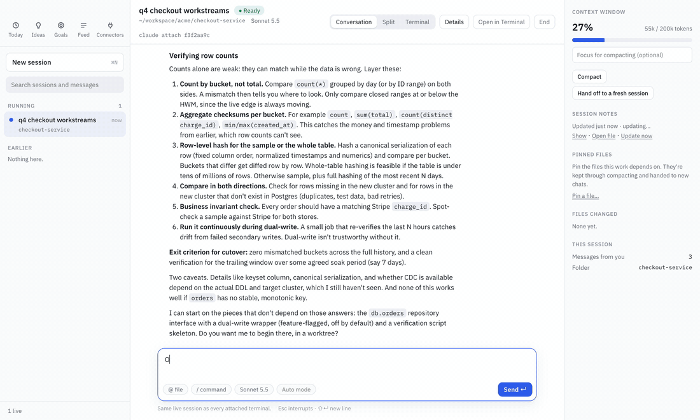
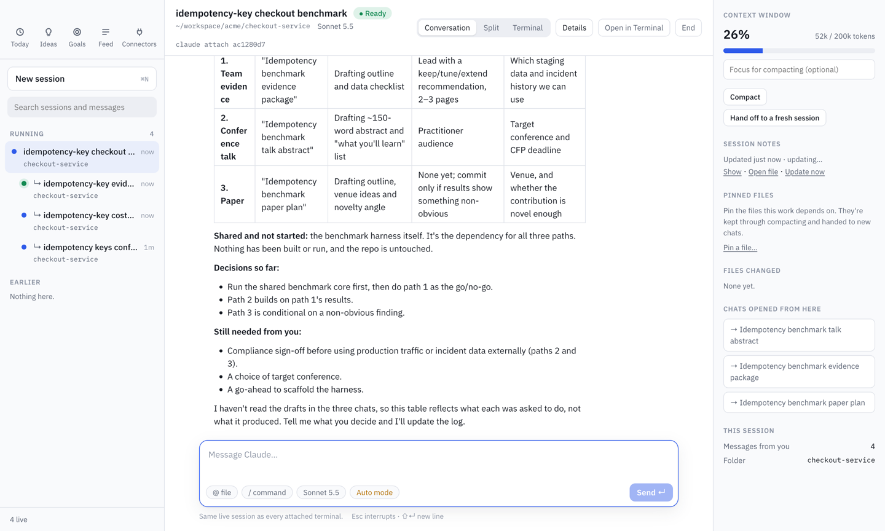

# Claude Companion

**Branch any Claude Code chat into linked sessions, and keep every session in one place.**

Claude Companion is an open-source desktop app around Claude Code. It runs your Claude Code sessions, shows them side by side, and lets one conversation split into separate, linked chats when the work splits.



<sub>Real recording, sped up. "Open a separate chat for the caching workstream" opens a new linked session that already knows the plan. Asked about it, the new chat answers from the parent's context. A second branch nests under the same parent. [MP4 version](docs/media/branching.mp4).</sub>

## Why

One chat rarely stays one topic. Claude gives you three plans and you start on the first; forty messages later the other two are buried, and the chat is full of context that has nothing to do with them. Opening a new chat by hand loses everything you already worked out, and nothing connects the chats afterwards.

With Companion you just say it, in Companion or in any attached terminal:

> *"Open a separate chat for the caching workstream."*

Companion branches it:

- **A new linked session opens and starts working right away**, on an opening message Claude writes for that topic.
- **It knows the earlier conversation as hidden background**: the parent's session notes plus its most recent exchanges. You never see that background in the new chat, so its thread stays clean, and it survives resumes.
- **It stays linked.** Child chats nest under their parent in the sidebar. The parent lists every chat opened from it, and one click on "from …" takes you back.
- **The parent becomes your decision log**: which path, what status, what's next.



Some ways to use it:

- **One plan, several workstreams.** Branch each workstream into its own clean chat and keep the plan in the parent.
- **One idea, several outputs.** A talk, a paper and an evidence package each get their own chat, with no context bleeding between them.
- **A failed attempt.** Branch the next approach instead of continuing in a chat full of the last one's dead ends. The new chat gets a short summary of what was ruled out, not the wreckage.

## Everything else

**Every session in one window.** Live and recent Claude Code sessions from all your projects are in the sidebar: *Needs you* (waiting for an approval or answer), *Running* and *Earlier*. Full-text search covers everything you and Claude wrote. The folder menu under the search box narrows the list to one project, its worktrees included, and is remembered across restarts. Opening a session shows the whole conversation: your messages, Claude's replies, and its tool calls collapsed into steps you can expand to see diffs and command output.

**Drive a session from anywhere.** Sessions run as Claude Code background sessions (`claude --bg`), which any number of terminals can attach to. Type in Companion's composer, its terminal pane, or a terminal where you ran `claude attach <id>`: it is one live session, and every place shows the same thing. Permission prompts appear as cards in the conversation; answer them there or in any attached terminal. **Open in Terminal** opens the session in iTerm or Terminal. **End** stops it (`claude stop`), and sending a message later continues it. Quitting Companion only detaches.

**Today.** A morning recap of yesterday's work by project, blockers and action items. "Start session" opens a new session on an item; "Continue where I left off" resumes the session it came from.

**Session notes.** After each turn, once the session goes quiet, Companion updates a Markdown notes file for the session with the goal, decisions, specifics (paths, commands, values, errors and fixes), constraints and open questions. Branches start from these notes, so they open instantly.

**Side chats.** Hover any message and click its reply arrow (**Ask on the side**) to ask about it in a thread beside the chat, like a Slack thread. Claude answers with the whole conversation in mind, but nothing you ask there is added to the chat, so it doesn't grow the chat's context or cost on later turns. The thread shows only the message it replies to. Answers come from a fork of the chat (`claude -p --resume <id> --fork-session`) on the same model, so a recently active chat's history is read from the prompt cache: each answer shows how many tokens came from the cache. Follow-ups continue the same thread. Threads are listed under **Side chats** in the header and badged on their message; deleting one deletes its fork.

**Context tools** (in the Details panel): a context-window meter that warns when it's getting full; **Compact** runs `/compact` with an optional focus; **Pinned files** are kept through compacting and handed to new chats; **Hand off to a fresh session** opens a new session that picks up from this one's notes.

## Install

Requires macOS, Node 20+ and [Claude Code](https://docs.anthropic.com/en/docs/claude-code).

```sh
git clone https://github.com/ashishkattamuri/claude-companion.git
cd claude-companion
npm install                # also rebuilds native modules for Electron
npm run build && npm link  # puts `companion` on your PATH

companion                  # open the desktop app
```

Other commands:

```sh
companion recap           # print today's recap
companion doctor          # check paths, data, live sessions, model usage and transcript-format compatibility
companion tools install   # branch from every Claude session, including ones started in iTerm
companion hooks install   # refresh summaries whenever a Claude Code session ends
```

Sessions Companion starts can branch out of the box. `companion tools install` registers Companion's branching tool for all Claude Code sessions (`claude mcp add --scope user`; `companion tools uninstall` removes it). If Companion is closed when you ask for a separate chat, it opens.

Sessions started as a plain `claude` in another terminal can only be typed into from that terminal, so Companion shows them live but read-only. Start them with `claude --bg` (then `claude attach <id>`) to drive them from both places.

Shortcuts: `⌘N` new session, `Enter` send, `⇧Enter` new line, `Esc` interrupt Claude.

## Privacy

Everything stays on your machine. Companion reads Claude Code's transcripts into a local SQLite database and keeps notes under `~/.local/share/claude-companion/`.

Summaries and notes run through `claude -p` on your own Claude login: Claude Code's own "away" recaps where available, Haiku for the rest, and one Sonnet call for the daily recap. Model calls are isolated (no tools, no hooks, no MCP servers, nothing saved as a session) and capped per run. `companion doctor` shows how many calls were made.

To exclude projects, create `~/.config/claude-companion/config.toml`:

```toml
[sources]
opt_out = ["~/work/secret-project", "~/clients/*"]
```

A pattern starting with `!` brings a folder back, so `["~/**", "!~/work/demo"]` shows only that one project.

## Development

```sh
npm run dev               # the app with hot reload
npm test                  # unit tests
npm run test:e2e          # drives the built app with Playwright and a fake `claude` (offline, free)
npm run test:live         # the same against the real Claude Code CLI on Haiku (a few cents)
npm run test:live-branch  # notes and branching against the real CLI
```

## Contributing

Issues and pull requests are welcome. See [CONTRIBUTING.md](CONTRIBUTING.md). If Companion saves you from a tangled chat, a ⭐ helps other people find it.

## License

MIT
